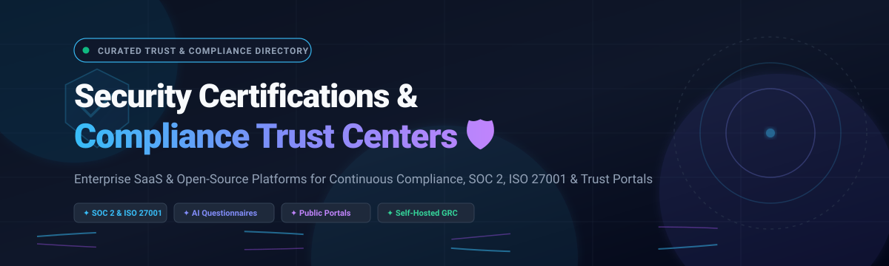

# 🛡️ Awesome Security Certifications & Compliance Trust Center 🚀

> **A curated, comprehensive directory of top-tier Security Certifications and Compliance Trust Center platforms — featuring enterprise SaaS solutions and open-source self-hosted alternatives for continuous compliance, automated SOC 2 & ISO 27001 audit workflows, vendor questionnaires, and public security posture trust portals.**

  
  
  
  
  
  

🌟 **Star this repository on GitHub if you find it valuable!** 🌟

---

## 📋 Table of Contents

- [🌐 Sector Overview & Market Dynamics](#-sector-overview--market-dynamics)
- [🟦 SaaS / Hosted Platforms](#-saas--hosted-platforms)
  - [📊 SaaS Platforms Comparison](#-saas-platforms-comparison)
- [🟩 Open-Source Software](#-open-source-software)
  - [1. CISO Assistant Community](#1-ciso-assistant-community)
  - [2. Comp (trycompai)](#2-comp-trycompai)
  - [3. Comply (StrongDM)](#3-comply-strongdm)
  - [4. Probo](#4-probo)
  - [5. Gapps](#5-gapps)
  - [6. Compliance Masonry](#6-compliance-masonry)
  - [7. OpenGRC](#7-opengrc)
  - [8. Kodus Trust Center](#8-kodus-trust-center)
- [📈 Comparison at a Glance](#-comparison-at-a-glance)
- [🤝 Contributing](#-contributing)
- [💖 Support & Sponsorship](#-support--sponsorship)
- [📊 Star History](#-star-history)
- [📄 License](#-license)

---

## 🌐 Sector Overview & Market Dynamics

The **Compliance Automation and Trust Center software market** is estimated at approximately **$35B to $39B** (projected to surge past **$75B+ by the mid-2030s** at an estimated **~14% CAGR**). In modern B2B SaaS procurement, public trust centers and continuous audit readiness have shifted from optional compliance checkboxes to mandatory sales enablement accelerators. 

The sector displays a **moderately fragmented yet rapidly consolidating landscape**: established venture-backed category giants (such as OneTrust, Vanta, and Drata) actively acquire innovative niche vendors (such as SafeBase and Tugboat Logic) to deliver end-to-end "Trust Operations" suites spanning automated evidence collection, AI-powered questionnaire response, and self-service buyer trust portals.

---

## 🟦 SaaS / Hosted Platforms

Commercial, cloud-hosted Security Certifications, Compliance Automation, and Trust Center platforms. Ranked in descending order of market scale and valuation.

### 📊 SaaS Platforms Comparison

| 🏢 Platform | 💰 Company Scale (Valuation / Revenue) | 🏷️ Starting Pricing (Paid Tier) | 🎁 Free Tier Limits / Free Trial | ⚡ Key Capabilities & Highlights |
|---|---|---|---|---|
| **OneTrust Trust Center** | Valuation: ~$5.0B / ARR: ~$500M+ | ~$10,000 / year (modular baseline) | No permanent free tier; time-limited sales sandbox / trial by request only | Comprehensive privacy, security & Responsible AI portal; broad ISO/SOC/industry certifications. |
| **Vanta Trust Center** | Valuation: ~$4.2B / ARR: ~$250M+ | ~$7,500 / year (Essentials tier) | No permanent free tier; guided evaluation / demo only (no open self-serve trial) | Full compliance automation suite, Clickwrap/DocuSign NDA workflows, CTM tagging, revenue attribution reporting. |
| **Drata Trust Center** | Valuation: ~$2.0B+ / Total Funding: ~$320M+ | ~$7,500 / year (Startup / Foundation tier) | No permanent free tier; guided sandbox / trial through partner/sales demo only | SafeBase-powered Trust Center, automated CRM access requests, AI questionnaire assistance (AIQA). |
| **Druva Trust Center** | Valuation: ~$2.0B / ARR: ~$200M+ | ~$35 to $75 / user / year (or consumption-based credits) | 30-day full-featured free trial (live onboarding checklist, cloud workload testing) | Dedicated customer security & compliance portal (security.druva.com) covering SOC 2, FedRAMP, ISO 27001, GovCloud attestations. |
| **SafeBase** | Valuation: $250M (Acquired by Drata) | ~$5,000 / year (Starter / Foundation paid plans) | Free Foundation plan: 1 trust center profile, capped document/Q&A items (~15 items), limited monthly request credits | Multi-product trust center consolidation, product pill filtering, intelligent badge de-duplication, AI questionnaire automation. |
| **TrustArc Trust Center** | Private Equity majority (Main Capital) / Funding: ~$109M | ~$8,000 / year (Baseline consent/compliance module) | 30-day time-bound evaluation trial (sales-provisioned pilot; no permanent free plan) | No-code trust center hub, privacy & subprocessor disclosures, consent/DSR workflow integration, version history tracking. |
| **Secureframe Trust Center** | Valuation: ~$250M–$500M / Peak ARR: ~$20M+ | $7,500 / year (Fundamentals tier) | No permanent free tier; sales-guided demo / pilot evaluation only (no open trial) | Trust Center included from entry tier, automated NDA workflows, custom domains, Comply AI, 300+ native integrations. |
| **Panorays Trust Center** | Total Funding: ~$62M / Est. ARR: ~$13M | ~$12,000 / year (Median contract ~$21,700/yr; modular tiering) | Permanent Free Starter Plan: 1 company profile, attack surface check, limited to evaluating up to 5 vendors | Third-party risk management integration, pre-filled public security profile, multiple trust centers per use case, NDA access controls. |
| **Whistic Trust Center** | Total Funding: ~$71M / Est. ARR: ~$11.5M | ~$10,000 / year (Core AI / Standard tier) | Free Basic Profile: 1 user seat, 1 profile published to Whistic Trust Catalog, capped at 3 proactive shares total | Vendor assessment & trust sharing, Whistic Trust Catalog publishing, questionnaire view analytics, profile engagement tracking. |
| **Tugboat Logic Trust Center** | Acquired by OneTrust (~$10M–$20M ARR segment) | ~$8,000 / year (Starter compliance tier) | No permanent free tier; customized guided sales demo only (no open self-serve trial) | AI-powered questionnaire automation with iterative learning knowledge base, coupled with customer-facing trust portal. |

---

## 🟩 Open-Source Software

Self-hosted, community-driven Security Certifications, Compliance Automation, GRC, and Trust Center software. Repositories are sorted in **descending order by GitHub stargazers**.

### 1. [CISO Assistant Community](https://github.com/intuitem/ciso-assistant-community) 
* **Repository:** [intuitem/ciso-assistant-community](https://github.com/intuitem/ciso-assistant-community)
* **Tech Stack:** Python / Django / React / Docker | **License:** AGPL-3.0
* **Overview:** A leading open-source GRC platform and compliance audit portal supporting over 200+ regulatory frameworks out of the box (including ISO 27001, SOC 2, NIST CSF, PCI DSS, GDPR, NIS2, and DORA). Provides cross-framework automated control mapping, vendor risk management (TPRM), continuous audit management, and interactive compliance dashboards.
* **Best for:** Security teams looking for an all-in-one open-source GRC system with extensive pre-mapped framework catalogs and self-hosted audit capabilities.

### 2. [Comp](https://github.com/trycompai/comp) 
* **Repository:** [trycompai/comp](https://github.com/trycompai/comp)
* **Tech Stack:** TypeScript / Next.js / Python | **License:** Open Source
* **Overview:** An AI-native, developer-first compliance automation platform designed as an open-source alternative to Vanta and Drata. Automatically collects infrastructure evidence from cloud providers (AWS, GCP, GitHub), validates security controls against SOC 2 and ISO 27001, and helps engineering teams maintain continuous compliance without manual spreadsheet tracking.
* **Best for:** Fast-moving engineering and security startups desiring an open-source, automated SOC 2/ISO compliance engine with native cloud integrations.

### 3. [Comply](https://github.com/strongdm/comply) 
* **Repository:** [strongdm/comply](https://github.com/strongdm/comply)
* **Tech Stack:** Go / CLI / Markdown | **License:** Apache-2.0
* **Overview:** StrongDM's compliance automation framework focused on SOC 2 compliance as code. Allows security teams to author and version-control company policies, automatically verify procedure enforcement through Git ticketing systems (Jira, GitHub Issues), and generate audit-ready documentation and checklists directly from version control.
* **Best for:** Developers and DevOps practitioners who prefer managing compliance policies and auditor evidence using Git-driven markdown workflows.

### 4. [Probo](https://github.com/getprobo/probo) 
* **Repository:** [getprobo/probo](https://github.com/getprobo/probo)
* **Tech Stack:** Go / PostgreSQL / GraphQL / MCP | **License:** ISC
* **Overview:** A modern, agent-ready open-source compliance suite supporting SOC 2, ISO 27001, and GDPR. Probo features public compliance trust pages, automated access reviews, vendor risk management, and first-class Model Context Protocol (MCP) tool support that enables AI agents (such as Claude Code or Cursor) to execute compliance audits directly.
* **Best for:** Modern teams seeking an extensible compliance platform featuring public trust pages, API/GraphQL control, and native AI agent tooling.

### 5. [Gapps](https://github.com/bmarsh9/gapps) 
* **Repository:** [bmarsh9/gapps](https://github.com/bmarsh9/gapps)
* **Tech Stack:** Python / Django / SQLite | **License:** GPL-3.0
* **Overview:** A lightweight, self-hosted security compliance tracking portal designed for multiple cybersecurity standards including SOC 2, CMMC, ASVS, ISO 27001, HIPAA, NIST CSF, NIST 800-53, CIS Controls, and PCI DSS. Offers centralized control status tracking and auditor assessment records.
* **Best for:** Small to mid-sized compliance teams needing a streamlined portal to cross-track control implementations across multiple federal and commercial standards.

### 6. [Compliance Masonry](https://github.com/opencontrol/compliance-masonry) 
* **Repository:** [opencontrol/compliance-masonry](https://github.com/opencontrol/compliance-masonry)
* **Tech Stack:** Go / CLI / YAML | **License:** Apache-2.0
* **Overview:** An open-source command-line tool implementing the OpenControl schema. Enables organizations to manage security documentation, system security plans (SSPs), and compliance certifications as structured code. Automates the compilation of YAML-based security specifications into certification-ready audit packages for NIST 800-53 and FedRAMP.
* **Best for:** Regulated cloud engineering teams who need to generate reproducible System Security Plans (SSPs) and documentation as code.

### 7. [OpenGRC](https://github.com/LeeMangold/OpenGRC) 
* **Repository:** [LeeMangold/OpenGRC](https://github.com/LeeMangold/OpenGRC)
* **Tech Stack:** PHP / Laravel / Filament | **License:** MIT
* **Overview:** A modern, self-hosted Governance, Risk, and Compliance web application designed for fast deployment. Provides a clean admin dashboard to track company assets, risks, compliance controls, vendor risks, and internal audit reviews without complex enterprise configuration.
* **Best for:** Small businesses and security consultants seeking a simple, self-hosted web UI for audit and risk tracking without licensing fees.

### 8. [Kodus Trust Center](https://github.com/kodustech/trust-center) 
* **Repository:** [kodustech/trust-center](https://github.com/kodustech/trust-center)
* **Tech Stack:** Next.js / TypeScript / Supabase | **License:** Open Source
* **Overview:** A free, self-hosted, YAML-driven trust center builder that allows companies to expose a public security portal instantly. Features include dark/light theming, compliance badges (SOC 2, ISO, HIPAA), gated document request modals stored in Supabase, an admin YAML editor with GitHub SSO, and zero vendor lock-in.
* **Best for:** Teams wanting an immediate, beautiful self-hosted trust center page that can be edited collaboratively via simple YAML files.

---

## 📈 Comparison at a Glance

| 🛠️ Software | 📜 License | 💻 Deployment Stack | 🌐 Public Trust Page | 🤖 AI / Automation | 🏢 Self-Hosted | 🎯 Ideal Use Case |
|---|---|---|---|---|---|---|
| **SafeBase** | Proprietary | Cloud SaaS | ✅ Multi-product | ✅ AI Questionnaires | ❌ | Multi-product trust center consolidation |
| **Vanta Trust Center** | Proprietary | Cloud SaaS | ✅ Draft & preview | ✅ Compliance automation | ❌ | Full compliance suite + trust portal |
| **Drata Trust Center** | Proprietary | Cloud SaaS | ✅ SafeBase engine | ✅ AI Questionnaire (AIQA) | ❌ | Enterprise GRC + buyer trust portal |
| **OneTrust Trust Center** | Proprietary | Cloud SaaS | ✅ Global portal | ✅ AI Governance | ❌ | Comprehensive privacy + security + AI trust |
| **Druva Trust Center** | Proprietary | Cloud SaaS | ✅ Customer hub | ❌ (Data protection) | ❌ | Data protection & cloud certifications |
| **Whistic Trust Center** | Proprietary | Cloud SaaS | ✅ Trust Catalog | ✅ Questionnaire AI | ❌ | Vendor assessment & proactive sharing |
| **Panorays Trust Center** | Proprietary | Cloud SaaS | ✅ Multi-portal | ❌ (Attack surface) | ❌ | TPRM-connected buyer trust center |
| **Secureframe Trust Center** | Proprietary | Cloud SaaS | ✅ Custom domain | ✅ Comply AI | ❌ | Mid-market automated compliance & trust |
| **CISO Assistant** | AGPL-3.0 | Django / React | (Internal portal) | ✅ 200+ framework mapping | ✅ | Enterprise self-hosted GRC & audit |
| **Comp (trycompai)** | Open Source | Next.js / Python | (Evidence hub) | ✅ Cloud evidence collector | ✅ | Open-source Vanta/Drata alternative |
| **Comply (StrongDM)** | Apache-2.0 | Go / CLI | (Docs / Git) | ✅ Git ticketing automation | ✅ | SOC 2 policy-as-code in Git |
| **Probo** | ISC | Go / GraphQL | ✅ Public portal | ✅ MCP tools & AI agents | ✅ | Agentic compliance + public trust page |
| **OpenGRC** | MIT | Laravel / Filament | (Admin UI) | ❌ Manual tracking | ✅ | Lightweight SMB risk & audit management |
| **Kodus Trust Center** | Open Source | Next.js / Supabase | ✅ YAML-driven | ❌ | ✅ | Dedicated self-hosted public trust center |

---

## 🤝 Contributing

Contributions are warmly welcomed! To suggest a new security certifications, compliance automation, or trust center tool:

1. Fork this repository 🍴
2. Create a new branch: `git checkout -b feature/add-new-tool`
3. Add your tool with project name, repository link, tech stack, license, star count, and a 2–3 sentence overview
4. Submit a Pull Request with a clear description 🚀

---

## 💖 Support & Sponsorship

If this curated list saved you time, helped you evaluate compliance vendors, or inspired your security program, please consider supporting the project:

- ⭐ **Star this repository** to help others discover it
- 🍴 **Fork and share** with your cybersecurity and DevSecOps peers
- ☕ **Support the maintainer:** You can buy a coffee or sponsor ongoing development via the [GitHub Sponsor Dashboard](https://github.com/sponsors/ishandutta2007)

Thank you for being part of the open-source security community! 🛡️✨

---

## 📊 Star History

---

## 📄 License

This compilation is released under the [CC0 1.0 Universal (Public Domain)](https://creativecommons.org/publicdomain/zero/1.0/). Listed software tools and brands retain their respective licenses and trademarks.
